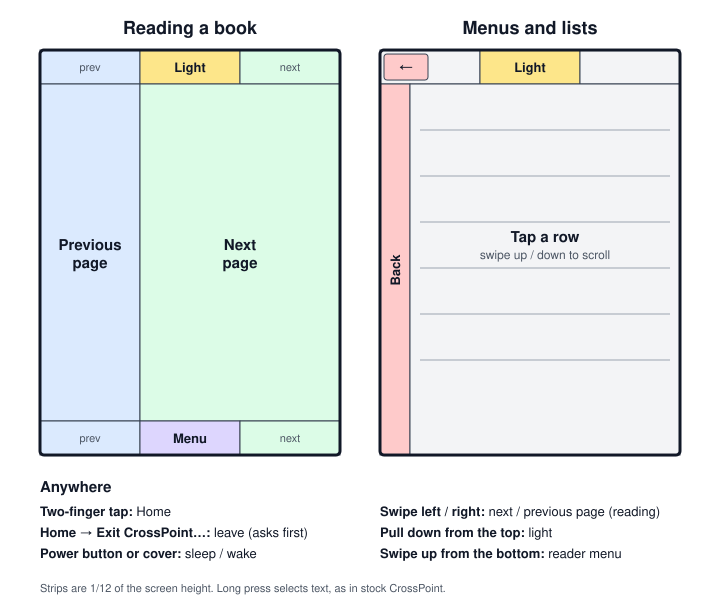

# CrossPoint Reader for Kindle

> **Work in progress.** Most things work, but there is more to do. Tested on
> the **Kindle Paperwhite 3** and the **Kindle Scribe (1st gen)**. Every other
> Kindle is untested: if you try one, please
> [report how it went](#reporting-a-test). That is how new models get
> supported.

An unofficial port of [CrossPoint Reader](https://github.com/crosspoint-reader/crosspoint-reader)
to jailbroken Kindles. It runs as an app, launched from KUAL or from a
scriptlet in the Kindle's Library, like KOReader. Leave it and you are back
in the normal Kindle UI.

CrossPoint is firmware for small ESP32 e-readers, so it cannot be flashed onto
a Kindle. This port starts from the project's desktop simulator, which already
compiles the firmware as a Linux program. It replaces the simulator's window,
mouse and keyboard with the Kindle's e-ink screen, touchscreen, power button
and cover sensor. Then it cross-compiles everything into one static ARM
binary, the same for every supported Kindle.

**Current version: v0.2.0.** See also [Known limitations](#known-limitations).

## Test status

What has been tried on each Kindle, kept up to date from test reports.
✅ works · ⚠️ works with problems · ❌ does not work · ❔ not tested yet ·
— not on this model

| Feature | Paperwhite 3 | Scribe (1st gen) | Paperwhite 2 |
| --- | --- | --- | --- |
| Starts, draws the home screen | ✅ | ✅ | ❔ |
| Touch: menus, file browser, Back | ✅ | ✅ | ❔ |
| Reading: page turns (tap and swipe) | ✅ | ✅ | ❔ |
| Images in books | ✅ | ✅ | ❔ |
| Reader menu and text settings | ✅ | ✅ | ❔ |
| Extra fonts from `fonts/` | ❔ | ✅ | ❔ |
| Front light | ✅ | ❔ | ❔ |
| Sleep and wake: power button | ✅ | ❔ | ❔ |
| Sleep and wake: cover | ✅ | ❔ | ❔ |
| Wi-Fi file transfer | ✅ | ❔ | ❔ |
| Battery level | ✅ | ❔ | ❔ |
| Exit back to the Kindle UI | ✅ | ✅ | ✅ (v0.1.0 report) |
| Pen | — | ❌ not used yet | — |
| Launched from | KUAL | Library scriptlet | KUAL |
| Firmware tested | 5.x | 5.19.4 | stock 5.x |

Other models (Paperwhite 4/5/6, Basic, Oasis, Voyage, later Scribes,
Colorsoft) are not tested. They may work, since the screen size, touch and
device paths are detected at startup. Facts per model are in
[docs/models.md](docs/models.md).

### Reporting a test

Open a [device report](../../issues/new?template=device-report.yml) (an
issue form). It asks for your model, firmware version and how you start
CrossPoint, a checklist of what worked, and these two files from the
`crosspoint` folder on the Kindle's USB drive:

1. **`crosspoint.log`**: written each time CrossPoint runs. Run one session
   first: open a book, turn a few pages, try the light, sleep and the cover,
   then Home → Exit CrossPoint….
2. **`probe.txt`**: run **CrossPoint Probe** from the Library (or **Probe
   this Kindle** in KUAL). It only reads facts about the device and changes
   nothing. It keeps only the model part of the serial number.

Photos of anything that looks wrong help too. If CrossPoint gets stuck, hold
the power button for about 40 seconds to restart the Kindle.

## What this port does

A summary of everything changed on top of CrossPoint and its simulator.
[CHANGELOG.md](CHANGELOG.md) has the release history.

**Runs on the Kindle**
- One static ARM binary (Cortex-A9, musl). It runs on both the older
  soft-float and newer hard-float Kindle firmware.
- A KUAL launcher pauses the Kindle UI while CrossPoint runs. It stops the
  status bar (no clock drawn over CrossPoint), keeps the Kindle screensaver
  away, and opens the firewall for file transfer. When CrossPoint exits or
  crashes, it puts all of that back.
- Leave from Home → **Exit CrossPoint…** (asks first).

**Screen**
- Draws on the e-ink panel through [FBInk](https://github.com/NiLuJe/FBInk).
  Only the changed rectangle is refreshed.
- Each page goes out as one 16-gray refresh instead of the firmware's
  separate black-and-white and gray passes.
- Zoom: the firmware lays out for ~220 ppi screens and the Paperwhite has
  300 ppi. The UI is drawn smaller and scaled up (default 125%, adjustable).
- Fixed 16-bit buffer offsets that overflowed on the larger panel and
  garbled the logo and book images.

**Touch** (no buttons on the Paperwhite)
- Reads the touchscreen directly and takes it over, so the paused Kindle UI
  never sees CrossPoint's touches.
- Taps and swipes both work, as on stock touch CrossPoint. Page taps always
  work, even if the page-turn setting says "swipe only" (the firmware's
  default).
- Touch zones for the things buttons do on other devices: light (top
  centre), reader menu (bottom centre), Back (left edge in menus).
  Two-finger tap = Home.

**Power**
- Sleep with the power button or by closing the cover. Wake the same way.
  The sleep screen stays up while the Kindle is in real suspend.
- Wi-Fi is off while CrossPoint runs. It turns on only for File Transfer.
- When idle, CrossPoint waits for input instead of waking 100 times a
  second.
- A once-a-minute power log, plus a matching log for the stock reader, so
  battery use can be compared.

**Books and files**
- The Library and Browse Files skip the Kindle's system folders and the
  jailbreak/KOReader folders. `.txt` and `.md` books show, as on stock
  CrossPoint.
- Battery level from the Kindle's gas gauge. Front light through the
  Kindle's own light control.

**Wi-Fi file transfer**
- Uses the Kindle's own Wi-Fi connection. The upload page works from any
  browser on the same network, at the address CrossPoint shows.

**Build**
- No PlatformIO. `tools/build.py` compiles the firmware, its SDK libraries
  and this HAL with Zig's clang, applying a short, documented list of edits
  to the firmware source (`SOURCE_PATCHES`).
- Every dependency is pinned to an exact revision, so any release can be
  rebuilt.

## Install

You need a jailbroken Kindle. CrossPoint starts either from KUAL (older
jailbreaks, as on the tested Paperwhite 3) or from a scriptlet in the Library
(modern jailbreaks on firmware 5.16.3 and newer, where KUAL no longer works).

1. Download `crosspoint-kindle-v<version>.zip` from this repository's
   Releases page.
2. Connect the Kindle over USB. Copy the zip's `extensions/crosspoint` folder
   into the Kindle's `extensions` folder (create `extensions` if it is not
   there). You should end up with `extensions/crosspoint/bin/crosspoint`.
3. Without KUAL: also copy the two files in the zip's `documents` folder
   (`CrossPoint Reader.sh`, `CrossPoint Probe.sh`) into the Kindle's
   `documents` folder. They show up in the Library like books.
4. Optional: copy the zip's `fonts` folder to the top of the Kindle drive for
   six extra reading fonts (see [Fonts](#fonts)).
5. Copy books anywhere on the Kindle, for example into `Books` or
   `documents`. EPUB works best; TXT, MD and XTC also open.
6. Eject. Start CrossPoint: with KUAL, **CrossPoint Reader → Start
   CrossPoint**; without it, tap **CrossPoint Reader** in the Library.

On a model not listed as working, it may still run; if it does not, run
**CrossPoint Probe** (or the KUAL item "Probe this Kindle"): it saves a
read-only report to `crosspoint/probe.txt`. Attach it, with
`crosspoint/crosspoint.log`, to a
[device report](../../issues/new?template=device-report.yml).

To update, copy the new `extensions/crosspoint` folder over the old one.
Your settings, reading positions and Library live elsewhere (in
`crosspoint/` and `.crosspoint/` on the drive) and are kept.

## Using it

Hold the Kindle upright (portrait). Strips are 1/12 of the screen height.



| Zone | Reading a book | Menus and lists |
| --- | --- | --- |
| Top strip | Centre third: **light**. Corners: like the page below | Left: header **←** back. Centre third: **light** |
| Bottom strip | Centre third: **reader menu**. Corners: like the page above | — |
| Left side | Left third: **previous page** | Left 10%: **Back** |
| Everything else | **Next page** | Tap a row |

| Gesture | |
| --- | --- |
| Swipe left / right | Next / previous page (reader); sideways actions in menus |
| Swipe up / down | Scroll lists |
| Pull down from the top edge | Light |
| Swipe up from the bottom edge | Reader menu |
| Long press | Select text (copy, dictionary), as in stock CrossPoint |
| Two-finger tap | Home |
| Power button, or close the cover | Sleep. Press again, or open the cover, to wake |
| Home → Exit CrossPoint… | Leave CrossPoint (asks first) |

If something goes badly wrong, holding the power button for 20–40 seconds
restarts the Kindle.

**Wi-Fi file transfer:** set up Wi-Fi in the Kindle's own settings first.
In CrossPoint choose **File Transfer → Join a Network → Kindle Wi-Fi**. It may
take a few seconds while the Kindle rejoins your network. Then open the
address it shows in a browser on the same network. Leaving File Transfer
turns Wi-Fi off again.

**Hidden folders:** the Library and Browse Files skip these top-level
folders: `audible`, `fonts`, `screenshots`, `system`, `voice` (Kindle) and
`extensions`, `koreader`, `apps`, `mrpackages`, `mesquito`, `libkh`
(jailbreak and KOReader). Names starting with a period are skipped too;
Browse Files shows them only if **Show hidden files** is on.

### KUAL menu

| Item | |
| --- | --- |
| Start CrossPoint | Normal start |
| Start CrossPoint (verbose log) | Also logs every touch |
| Show last log | Prints the end of the last log on screen |
| Power log for the stock reader (60 min) | Logs battery use while you read in the Kindle's own reader |
| Stop the power log | Ends that log early |
| Probe this Kindle (for new models) | Saves facts about the device (screen, touch, battery, light, cover, sleep) to `crosspoint/probe.txt`. Read-only; keeps only the model part of the serial number |

The log is `crosspoint/crosspoint.log` on the Kindle's USB drive (the one
before it is `crosspoint.log.old`).

## Fonts

CrossPoint has one built-in font (Noto Sans). The zip adds six reading fonts
in its `fonts` folder, all under the SIL Open Font License:

| Font | |
| --- | --- |
| Literata | Google Play Books' reading font |
| Merriweather | Made for screens; sturdy |
| EB Garamond | Classic book face |
| Lora | Calligraphic, warm |
| Noto Serif | Serif partner of the built-in Noto Sans |
| Atkinson Hyperlegible | Designed for legibility and low vision |

Copy the zip's `fonts` folder to the top of the Kindle's USB drive, then pick a
font in **Settings → Reader → Font Family** (or the reader toolbar's text
panel). All have real bold and italic.

Add your own the same way: a `.ttf` or `.otf` file in `fonts/` works as is
(`fonts/MyFont.ttf` appears as "MyFont"); for bold and italic, put a family's
files in one folder (`fonts/MyFont/MyFont-Regular.ttf`, `-Bold.ttf`, ...).
`.cpfont` files from
[crosspoint-fonts](https://github.com/crosspoint-reader/crosspoint-fonts)
also work. See CrossPoint's
[SD card fonts guide](https://github.com/crosspoint-reader/crosspoint-reader/blob/master/docs/sd-card-fonts.md).

## Settings

CrossPoint's own settings are in its Settings screen, as on any CrossPoint
device. On this port **Settings → Reader → Screen Margin** goes up to 250
(40 on stock CrossPoint), for shorter lines on large screens. For bigger
text and menus overall, use `CPK_ZOOM` below. Settings for the Kindle side are in
`extensions/crosspoint/crosspoint.conf`. Each one is explained in the file.
Remove the `#` to turn one on.

| Setting | Default | |
| --- | --- | --- |
| `CPK_ZOOM` | `125` (PW3), `200` (Scribe) | Interface size in percent (100–200): text, menus and tap targets. The default grows with the screen, so the Scribe shows the PW3's layout, bigger. `136` on the PW3 matches the Xteink X4's physical size. |
| `CPK_FAST_WAVEFORM` | `GL16` | E-ink waveform for page turns and menus: `GL16`, `REAGL` (less flashing), `DU`/`A2` (faster, no grays), `GC16`, `AUTO`. |
| `CROSSPOINT_SIM_SD` | `/mnt/us` | The folder CrossPoint treats as its SD card (the whole USB drive). |
| `CPK_KEEP_WIFI` | `0` | `1` leaves Wi-Fi on while CrossPoint runs. |
| `CPK_POWER_LOG` | `1` | `0` turns the minute-by-minute power log off. |
| `CPK_IDLE_WAIT_MS` | `500` | Longest idle wait for input. `0` restores the stock loop (wakes every 10 ms). |
| `CPK_TOUCH_SWAP_XY`, `CPK_TOUCH_MIRROR_X`, `CPK_TOUCH_MIRROR_Y` | from FBInk | Manual touch fixes. Not needed on the PW3. |
| `CPK_TOUCH_DEVICE` | auto | Force a touchscreen device, e.g. `/dev/input/event1`. |
| `CPK_DEBUG_TOUCH` | off | `1` logs every touch release. |
| `CROSSPOINT_SIM_HTTP_PORT` | `80` | File transfer port (WebSocket uses the next one). |

## Power and battery

- **Sleep** suspends the Kindle's kernel directly (`mem` to
  `/sys/power/state`). The Kindle's own power daemon cannot do it while its
  UI is paused. If the kernel refuses, the sleep screen stays up and the
  next power press or cover opening wakes it. Power presses are ignored for
  3 s after a wake, so extra presses don't send it straight back to sleep.
- **Wi-Fi** is off while CrossPoint runs (the radio draws power even when
  idle). File Transfer turns it on and leaving File Transfer turns it off.
  On exit, Wi-Fi goes back to how it was.
- **Idle:** after 3 s without input, the main loop blocks until a touch or
  power-button event, or 500 ms. On Home that is about 2 wake-ups a second
  instead of about 100.
- **Power log:** once a minute, `crosspoint.log` gets a line like

  ```
  [power] up 12 min | battery 87% 3950 mV -45 mA | CrossPoint CPU 0.4% | system busy 1.1% | loop 2/s | light 36 | wifi off
  ```

  Sleep and wake add a battery line each. To compare with the stock reader,
  run **Power log for the stock reader (60 min)** from KUAL and read for the
  same time at the same light level; it writes `crosspoint/power-stock.log`.

## Troubleshooting

- **Nothing happens when I tap a page:** update to v0.1.0 or later (page taps
  can no longer be switched off by a reset setting).
- **Sleep or wake misbehaves:** the log records every power-button press
  (`power key down/up`), each suspend (`resumed after N s suspended`) and what
  woke it (`interrupts during suspend`). If presses are not logged at all, the
  Kindle itself is not delivering them; a forced restart (hold power 20–40 s)
  has fixed that before.
- **CrossPoint won't start:** check `crosspoint/crosspoint.log`. Exit code 3
  means no display, 4 means no touchscreen. The Kindle UI comes back either
  way.
- **The Kindle UI looks stuck after a crash:** the launcher's cleanup normally
  restores it. If not, restart the Kindle (hold power 20–40 s).

## How it works

| Piece | What it does |
| --- | --- |
| `kual/crosspoint/` | The KUAL extension. `bin/crosspoint.sh` pauses the Kindle UI (SIGSTOP on `cvm` and `awesome`, stops the status bar, disables pillow, sets `preventScreenSaver`), turns Wi-Fi off, opens ports 80, 81 and UDP 8134, runs CrossPoint and undoes everything on exit. `bin/powerlog.sh` is the stock-reader power log. |
| `src/simulator_main.cpp` | Entry point: the simulator's frame loop without SDL. |
| `src/KindleScreen.*` | Scales the firmware buffer up (bilinear), rotates it onto the portrait panel, finds the changed rectangle, copies it into `/dev/fb0` and refreshes it through FBInk. |
| `src/KindleGeometry.h` | Zoom: the size of the buffer the firmware draws into. |
| `src/HalDisplay.cpp` | The simulator's display HAL, now feeding `KindleScreen`. Sends B/W + gray as one refresh. |
| `src/KindleInput.*` | Reads the touchscreen (evdev multitouch A/B or single-touch) and power key. Two-finger tap = Home. |
| `src/HalGPIO.cpp` | Input HAL: touch → firmware coordinates, Back strip, power button and cover → sleep, kernel suspend and wake, the idle wait. |
| `src/WiFi.h`, `src/KindleNet.h` | Wi-Fi API backed by the Kindle's own connection; radio on/off. |
| `src/WebServer.cpp`, `src/WebSocketsServer.cpp`, `src/SimulatorNetworkPorts.h` | File transfer on all interfaces, ports 80/81. |
| `src/HalPowerManager.cpp`, `src/HalFrontlight.cpp` | Battery level from sysfs; front light through `lipc-set-prop com.lab126.powerd flIntensity`. |
| `src/KindlePowerLog.*` | The once-a-minute power log. |
| `src/KindleSettings.cpp` | One-time steps at first start: tap page-turn defaults, Library re-index. |
| `src/BoardConfig.h`, `src/EInkDisplay.h` | A Kindle board profile on the touch-first Metalio E-Ink 4 Plus code paths. |
| `tools/build.py` | The build, including `SOURCE_PATCHES`: every edit this port makes to the firmware source, each with its reason. |

The rest of `src/` is the
[crosspoint-simulator](https://github.com/crosspoint-reader/crosspoint-simulator)
at `84c3421`. Changed lines in the simulator's files are marked `Kindle:`,
and `git log` shows every change on top of the first commit (the unmodified
simulator).

## Building

Needs Linux or macOS with python3 (with pip), git, make and perl.

```sh
tools/setup.sh   # once: Zig, FBInk, OpenSSL, Arduino libraries, firmware
tools/build.py --firmware ../crosspoint-reader --deps ../deps \
               --sysroot ../kindle-sysroot --tc ../kindle-tc/kindle-
                 # -> build/crosspoint (static ARM binary, about 9 MB)
tools/package.sh # -> build/crosspoint-kindle-v<version>.zip
```

`tools/setup.sh` puts everything next to this repository and pins every
revision:

| | Revision |
| --- | --- |
| CrossPoint Reader firmware | `6e7caa2` (with its `freeink-sdk` submodule) |
| FBInk | `ded92fa` (built with `FBINK_MINIMAL`) |
| OpenSSL | `3.0.15` |
| ArduinoJson / QRCode / AnimatedGIF | `v7.4.2` / `eafbde4` / `d01888f` |
| Zig (compiler) | `0.17.1` |

The build does not use PlatformIO. `tools/build.py` compiles the source set
PlatformIO would pick for the simulator (firmware `src/` and `lib/`, the
FreeInk SDK libraries the simulator links, and this repository) with Zig's
clang for `arm-linux-musleabihf`, Cortex-A9, and links it statically. It
compiles from `build/fw`, a hard-link mirror of the firmware in which only the
patched files are edited copies, so the firmware checkout stays untouched.

**Newer firmware:** if an edit in `SOURCE_PATCHES` no longer matches, the
build stops and names the file; update that edit. If the firmware adds HAL
methods, add matching no-ops in `src/Hal*.h` (the simulator's "HAL stub
rule").

### Automatic builds

GitHub Actions (`.github/workflows/build.yml`) builds every push and pull
request: setup, build, the touch unit test, a 20-second start-up run under
`qemu-arm`, and the zip, which is kept as a downloadable artifact on the run's
page. The toolchain and dependencies are cached by the hash of
`tools/setup.sh`.

### Making a release

1. Set the version in `VERSION` and add a `## v<version> (<date>)` section to
   `CHANGELOG.md`.
2. Commit, tag the commit `v<version>` and push the tag. The workflow checks
   the tag matches `VERSION`, builds, and publishes a GitHub release with the
   zip and that CHANGELOG section as its notes.
3. If you change a pinned revision in `tools/setup.sh`, update the table in
   [THIRD_PARTY_NOTICES.md](THIRD_PARTY_NOTICES.md) too: it is where the
   binary's GPL source offer points.

To release by hand instead: build, run `tools/package.sh`, and attach
`build/crosspoint-kindle-v<version>.zip` to the release.

## Testing

- **Touch parser unit test** (runs on the build machine):

  ```sh
  g++ -std=c++17 -Isrc tests/kindle_input_test.cpp -o /tmp/kit && /tmp/kit
  ```

  Covers tap, swipe, two-finger tap and hold, axis transforms and
  `SYN_DROPPED`.

- **The whole app under `qemu-arm`**, without a Kindle. `CPK_FAKE_FB=<dir>`
  writes every screen refresh to `<dir>/frame-NNNN.pgm` instead of
  `/dev/fb0` (`CPK_FAKE_PANEL=1860x2480` for a Scribe-sized panel; default
  PW3), and `CROSSPOINT_SIM_SD=<dir>` is the fake USB drive:

  ```sh
  CPK_FAKE_FB=/tmp/frames CROSSPOINT_SIM_SD=/tmp/sd \
  CROSSPOINT_SIM_INPUT_SCRIPT='0:WAIT:Entering activity: Home;1500:TAP:120,418;0:WAIT:Entering activity: Library;3000:QUIT' \
  qemu-arm build/crosspoint
  ```

  `CROSSPOINT_SIM_INPUT_SCRIPT` is a `;`-separated list of `ms:ACTION[:args]`.
  Actions include `TAP:x,y`, `SWIPE:x1,y1,x2,y2,ms`, `WAIT:regex` (waits for a
  log line and starts a new time segment), `HOME`, `SLEEP` and `QUIT`.
  Coordinates are in the zoomed portrait layout (853×1152 on the PW3 at
  125%, 930×1240 on the Scribe at 200%). Test-only
  switches:
  - `CPK_TEST_SLEEP=1` with `CPK_POWER_STATE_PATH`/`CPK_HALL_PATH` exercises
    sleep against fake sysfs files.
  - `CPK_TEST_POWER_TAP_MS=<ms>` injects a quick power-button tap.
  - `CPK_TEST_IP_DELAY_MS=<ms>` pretends the Kindle is still rejoining Wi-Fi.
  - `CPK_TEST_IDLE_WAIT=1` keeps the idle wait on in scripted runs.
  - `CPK_POWER_LOG_SEC=<s>` shortens the power-log interval.

## Known limitations

- Fully tested on the Paperwhite 3 only; see [Test status](#test-status).
  The Scribe's pen is not used. Other touch Kindles may work (FBInk and the
  input code are generic) but need trying: the probe report helps add them.
  Models with page buttons get no button support yet.
- The firmware's Wi-Fi screens are a thin layer over the Kindle's own
  connection. Join networks in the Kindle's settings; hotspot mode and
  network scanning do nothing useful.
- Firmware update (OTA) is disabled, as in the simulator.
- Bluetooth page turners are not supported.

## Credits

- [CrossPoint Reader](https://github.com/crosspoint-reader/crosspoint-reader)
  and its contributors: the firmware this runs.
- [crosspoint-simulator](https://github.com/crosspoint-reader/crosspoint-simulator)
  by Julia Nguyen: the base of this repository.
- [FBInk](https://github.com/NiLuJe/FBInk) by NiLuJe: e-ink output.
- [KOReader](https://github.com/koreader/koreader): the model for running a
  reader as a KUAL app on a jailbroken Kindle.
- This port was developed with help from Claude (Anthropic).

## License

The source code in this repository is MIT (see [LICENSE](LICENSE)), like
CrossPoint Reader and the simulator. The release binary links FBInk
(GPL-3.0-or-later), so the binary as a whole is distributed under GPLv3. Its
complete source is this repository at the release tag plus the pinned
upstream revisions listed in
[THIRD_PARTY_NOTICES.md](THIRD_PARTY_NOTICES.md), which also has every
third-party license.

Kindle and Paperwhite are trademarks of Amazon. This project is not
affiliated with Amazon or with the CrossPoint Reader project.
